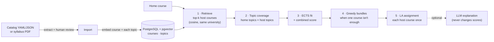

# Erasmatch

**Find equivalent university courses for your Erasmus Learning Agreement: across languages, with scores you can explain.**

Before an Erasmus exchange, every student has to fill in a *Learning Agreement*: for each course at the home university, find one or more courses at the host university with similar content and enough credits. In practice that means reading dozens of syllabi in another language and comparing them by hand. Credits are often split differently (one 9-credit Italian course can equal two 6-credit Spanish ones), so a simple one-to-one search isn't enough.

Erasmatch automates the first draft:

- **Multilingual matching.** Embeddings compare an Italian syllabus with a Spanish or English one.
- **Topic-level coverage, not just one similarity number.** It reports *which* home topics are covered and which are missing.
- **ECTS checks and bundles.** When no single course is enough, it proposes combinations like *Redes de Computadores + Transmisión de Datos*.
- **Whole-agreement drafts.** It assigns host courses to all your home courses without using the same course twice, then exports to Markdown, CSV or JSON.
- **Explanations from an LLM, which never changes the score** (see [design decisions](#design-decisions)).
- **Syllabus extraction.** It turns a PDF syllabus into a structured course that you review before importing.

It's a FastAPI service with a CLI, backed by PostgreSQL + pgvector. It runs fully locally with Ollama (bge-m3 + Qwen 2.5 7B fit on an 8 GB GPU) or with any OpenAI-compatible API.

---

## Demo

The example below uses the **two fictional catalogs** in `data/examples/` and the **offline embedder**, so no model or database is needed (see [Quickstart](#quickstart)).

```console
$ erasmatch la UNIEX UEJ --courses RETI,BASIDATI,CALCOLATORI,INGSW,IA,WEB \
    -c data/examples/home_uniex.yaml -c data/examples/host_uej.yaml
```

| Home course | ECTS | Host course(s) | ECTS | Coverage | Verdict | Note |
|---|---:|---|---:|---:|---|---|
| Reti di Calcolatori (RETI) | 9 | Redes de Computadores + Transmisión de Datos y Redes (RC + TDR) | 12 | 67% | possible |  |
| Basi di Dati (BASIDATI) | 9 | Bases de Datos + Administración de Bases de Datos (BD + ABD) | 12 | 67% | possible |  |
| Calcolatori Elettronici (CALCOLATORI) | 9 | Computer Architecture (AC) | 6 | 75% | possible | Credits below requirement (6/9). |
| Ingegneria del Software (INGSW) | 6 | Ingeniería del Software (ISW) | 6 | 67% | possible |  |
| Fondamenti di Intelligenza Artificiale (IA) | 6 | Sistemas Inteligentes + Machine Learning (SI + AA) | 12 | 83% | strong |  |
| Tecnologie Web (WEB) | 6 | Desarrollo de Aplicaciones Web (DAW) | 6 | 83% | strong |  |

Topic alignment for one course (`erasmatch match UNIEX BASIDATI UEJ --topics ...`):

```text
 #  score  cover   ECTS  verdict   host course(s)
 1   0.59    67%     12  possible  Bases de Datos + Administración de Bases de Datos [BD + ABD]
 2   0.37    33%     6!  weak      Bases de Datos [BD]

Topic alignment for option 1 [BD + ABD]:
  ok 0.65  Algebra relazionale                  ->  Álgebra relacional
  ok 0.47  Controllo della concorrenza          ->  Control de concurrencia
  -- 0.24  Linguaggio SQL: interrogazioni, ...  ->  Lenguaje SQL: consultas, joins y agregaciones
  ...
```

The offline embedder only sees shared character n-grams. It pairs the SQL topics correctly but can't tell that *interrogazioni* and *consultas* mean the same thing, so it scores them below the threshold. A semantic multilingual model like bge-m3 closes exactly that gap. That's why the offline embedder is for tests and CI, and the real model is for real use.

---

## Quickstart

### 1. Try it in 30 seconds (no database, no model)

```bash
pip install -e .
export ERASMATCH_EMBEDDER=hashing ERASMATCH_LLM=none   # PowerShell: $env:ERASMATCH_EMBEDDER="hashing"
erasmatch match UNIEX RETI UEJ --topics \
  -c data/examples/home_uniex.yaml -c data/examples/host_uej.yaml
```

`-c/--catalog` loads catalogs into memory for a single command.

### 2. Full stack: PostgreSQL + pgvector + Ollama

```bash
# Models (run Ollama on the host to use your GPU)
ollama pull bge-m3
ollama pull qwen2.5:7b-instruct

# API + database (migrations run on startup)
docker compose up -d --build

# Import the example catalogs and query the API
docker compose exec api erasmatch import data/examples/home_uniex.yaml data/examples/host_uej.yaml
curl -s localhost:8000/match -H 'content-type: application/json' \
  -d '{"home_university":"UNIEX","home_course":"RETI","host_university":"UEJ","explain":true}'
```

Interactive API docs: <http://localhost:8000/docs>.

### 3. Your own universities

Write one YAML file per university. Course codes must be unique within a university, and topics are the syllabus items, one per entry:

```yaml
university: { code: HOST, name: My Host University, country: ES, language: es }
courses:
  - code: RC
    title: Redes de Computadores
    ects: 6
    topics:
      - Modelo de capas TCP/IP
      - Programación con sockets
```

If you only have the PDF syllabus, extract a draft and review it before importing:

```bash
erasmatch extract guia_docente.pdf -o course.yaml
```

---

## API

| Method | Path | Description |
|---|---|---|
| `GET` | `/health` | Status, storage backend, active models |
| `POST` | `/catalogs` | Create/update a university and its courses (embeddings are computed here) |
| `GET` | `/universities` | List universities |
| `GET` | `/universities/{code}/courses` | Courses, including the topics actually used for matching |
| `GET` | `/universities/{code}/courses/{course}` | One course |
| `POST` | `/match` | Ranked options (single courses and bundles) for one home course |
| `POST` | `/learning-agreement` | Full draft; each host course is used at most once |
| `POST` | `/extract` | Syllabus PDF/text → course draft + warnings (needs an LLM) |

Errors are mapped explicitly:

- `404`: unknown university or course.
- `409`: stored embeddings come from a different model than the one configured.
- `501`: an LLM-only endpoint was called with the LLM disabled.
- `503`: the model provider is unreachable.

---

## How matching works



1. **Retrieval.** Each course is embedded as *title + description + topics*. The `k` closest courses of the host university are candidates (`ERASMATCH_CANDIDATES`, default 20).
2. **Topic coverage.** Each syllabus topic is embedded on its own. For every home topic we take the most similar topic of the candidate. The topic is *covered* if that similarity clears `ERASMATCH_TOPIC_THRESHOLD`. Coverage = covered topics / home topics.
3. **Score.**
   `score = 0.6·coverage + 0.25·course_similarity + 0.15·ects_fit − 0.03·(courses_in_bundle − 1)`
   `ects_fit = min(1, host_ects / (home_ects · min_ects_ratio))`. All weights can be configured.
   **Verdict:** `strong` (coverage ≥ 75% and enough credits), `possible` (≥ 50%), `weak` otherwise.
4. **Bundles.** This is a small weighted set-cover problem. A greedy pass adds, one at a time, the candidate that covers the most still-uncovered topics. It stops once coverage and credits are satisfied, or at 3 courses.
5. **Learning Agreement.** Options are assigned greedily by score. A host course already used for another home course is skipped.

---

## Design decisions

These are the trade-offs I would discuss in a review.

- **The LLM explains, it never scores.** Rankings come from deterministic, unit-tested numpy code, so the same input always gives the same output. The LLM receives the computed alignment and writes two sentences about it, under a JSON schema and at temperature 0. If it fails or is disabled, a template takes over. This keeps results reproducible and cheap, and the LLM can't invent a match.
- **Coverage per topic instead of one cosine score.** A single similarity between two course descriptions hides *what* is missing, and that is exactly what a coordinator asks about. Per-topic alignment makes every score inspectable (`--topics`, `alignments` in the API).
- **Exact search, no ANN index (yet).** Queries are always filtered by university, and a university has a few hundred courses. A sequential scan with `<=>` is exact and fast at that size. An HNSW index with a filter can return fewer than `k` rows unless iterative scans are enabled, so it only pays off with many thousands of courses per university.
- **The embedding model is stored with every vector.** Mixing vectors from two models gives meaningless similarities without any error. Erasmatch refuses to compare them (`409`) and asks you to re-import.
- **PDF extraction is human-in-the-loop.** Syllabi vary a lot, and a wrong credit value would silently corrupt every match that uses it. `/extract` returns a draft with warnings and never writes to the database.
- **Providers are plugged in through small `Protocol`s.** Ollama, any OpenAI-compatible API, or a deterministic offline embedder. The offline one makes the test suite and CI run without network or GPU.
- **Two repository implementations behind one interface.** PostgreSQL in production; in-memory for unit tests and for `--catalog` runs. Integration tests check that both return the same ranking.

---

## Evaluation

`data/examples/gold_uniex_uej.yaml` lists hand-labelled equivalences. `erasmatch eval` reports hit@1, hit@3 and MRR. Use it to compare models and to tune the topic threshold.

```console
$ ERASMATCH_EMBEDDER=hashing erasmatch eval data/examples/gold_uniex_uej.yaml -c ... -c ...
hit@1 1.00   hit@3 1.00   MRR 1.00   (n=9)
```

Take this number with a grain of salt. The example catalogs are small, fictional and full of Italian/Spanish cognates, so they make a regression test, not a benchmark. The next step is a labelled set built from real Learning Agreements, measured with each embedding model.

| Embedder | hit@1 | MRR | Notes |
|---|---:|---:|---|
| `hashing-v1` (offline) | 1.00 | 1.00 | example catalogs only |
| `ollama:bge-m3` | – | – | run `erasmatch eval` and fill in |

---

## Configuration

All settings are environment variables (or a `.env` file, see `.env.example`).

| Variable | Default | Meaning |
|---|---|---|
| `ERASMATCH_DATABASE_URL` | `memory://` | `postgresql+psycopg://...` for PostgreSQL |
| `ERASMATCH_EMBEDDER` | `ollama` | `ollama`, `openai` or `hashing` |
| `ERASMATCH_EMBEDDING_MODEL` / `_DIM` | `bge-m3` / `1024` | the dimension must match the DB schema |
| `ERASMATCH_LLM` | `ollama` | `ollama`, `openai` or `none` |
| `ERASMATCH_LLM_MODEL` | `qwen2.5:7b-instruct` | used for explanations and extraction |
| `ERASMATCH_EXPLANATION_LANGUAGE` | `en` | `it`, `es`, `en`, ... |
| `ERASMATCH_TOPIC_THRESHOLD` | per embedder | bge-m3: 0.6 (starting point, calibrate it) |
| `ERASMATCH_MIN_ECTS_RATIO` | `1.0` | e.g. `0.8` if your university tolerates fewer credits |
| `ERASMATCH_TARGET_COVERAGE` / `_MIN_COVERAGE` | `0.75` / `0.5` | verdict thresholds |
| `ERASMATCH_OPENAI_BASE_URL` / `_API_KEY` | OpenAI | any compatible endpoint (vLLM, LM Studio, ...) |

---

## Project structure

```text
src/erasmatch/
├── api/app.py          FastAPI routes and error mapping
├── cli.py              Typer CLI (match, la, import, extract, eval, serve, migrate)
├── service.py          wiring + catalog import (embedding of courses and topics)
├── matching/
│   ├── engine.py       pipeline orchestration
│   ├── scoring.py      coverage, ECTS fit, score, verdict (pure numpy)
│   ├── bundles.py      greedy set cover
│   └── agreement.py    host-course assignment
├── embeddings/         ollama · openai-compatible · offline hashing
├── llm/                providers (JSON-schema output), explainer, PDF extractor
├── storage/            repository protocol, in-memory, PostgreSQL/pgvector
├── migrations/         Alembic
└── evaluation.py       hit@k / MRR against labelled pairs
tests/                  unit, API, CLI and PostgreSQL integration tests
```

## Development

```bash
pip install -e ".[dev]"
make lint test                       # ruff + unit/API/CLI tests (no network needed)
docker compose up -d db && make test-pg   # integration tests on real pgvector
```

GitHub Actions runs lint, the full test suite against a `pgvector/pgvector:pg16` service container, and the Docker build.

## Limitations and roadmap

- [ ] Catalog importers for real university websites (one adapter per site), with polite rate limiting
- [ ] OCR for scanned syllabi
- [ ] Background jobs for large imports (the API embeds synchronously today)
- [ ] A labelled evaluation set from real Learning Agreements; threshold calibration per model
- [ ] Optimal assignment (small ILP) instead of greedy when options conflict
- [ ] Minimal web UI and export in the Online Learning Agreement format

The suggestions are a starting point for a conversation with your Erasmus coordinator, not an official recognition.

## Data notice

`data/examples/` contains **fictional** universities and syllabi written for testing. They don't describe any real institution.

## License

MIT
